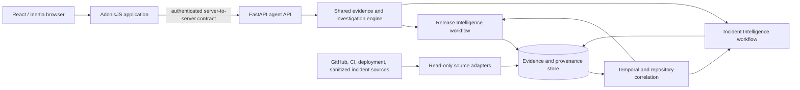

# Architecture

Viridian is one product with two specialized investigation workflows: Release
Intelligence evaluates delivery evidence before a release, and Incident
Intelligence investigates failures after deployment. They share evidence
contracts, provenance, repository and deployment metadata, correlation, tools,
workflow state, authorization, history, and evaluation fixtures.

The current repository is a foundation, not the implementation of this target
architecture. AdonisJS currently provides the existing authentication and
user-facing application; FastAPI currently exposes health, readiness, and a
versioned API root. The investigation engine and internal service integration
are planned work.

## System context

The diagram shows the intended direction. Initially, incident sources should be
manually submitted sanitized evidence; live observability integrations and
GitHub App access are later milestones.

## Ownership boundaries

### AdonisJS + React/Inertia (`apps/web`)

AdonisJS owns the web application, authentication, users and workspaces,
authorization, repository connections, frontend-facing APIs, and browser
sessions. React and Inertia remain inside this application. AdonisJS is the
server-side gateway for browser workflows and the owner of user-facing
persistence and access checks.

The browser must not call privileged FastAPI routes directly.
AdonisJS-to-FastAPI calls need an explicit internal contract and service
authentication. The two services must not share a cross-service ORM or duplicate
user authentication.

### FastAPI (`apps/agent-api`)

Python owns evidence collection and analysis, investigation workflow execution,
deterministic checks, agent orchestration, bounded tool execution, and
structured findings. Pydantic models define service contracts and domain
schemas. HTTPX is used for outbound HTTP adapters. Python does not directly
access the AdonisJS database.

### Shared platform concepts

The workflows share these capabilities rather than becoming separate AI
platforms:

- Evidence schema with source, repository, immutable revision, timestamp, and
  provenance references.
- Repository, deployment, and change metadata with event time and observation
  time kept separate.
- Read-only adapters and bounded tool calls with explicit timeouts and quotas.
- Structured investigation state, findings, citations, cancellation, and
  history.
- Authorization and tenant boundaries at service and provider boundaries.
- Synthetic fixtures and evaluation cases for deterministic and model-assisted
  behavior.

## Investigation workflows

### Release Intelligence

An investigation starts from a repository and immutable target revision or
release range. The workflow gathers linked issues and pull requests,
requirements, changes, tests and CI results, dependency changes, and policy
inputs. Deterministic checks report what evidence is present or missing;
configurable policy evaluation produces repeatable readiness findings.
Model-assisted reasoning may explain relationships and summarize risks while
citing evidence. The report calls out blockers, limitations, and unknowns.

### Incident Intelligence

The first workflow accepts a manually submitted, sanitized incident record with
timestamps, normalized errors, stack traces, and selected logs. It gathers
relevant deployment and source-control evidence, correlates candidate changes by
repository and time, and applies deterministic diagnostic rules. A model may
rank hypotheses and recommend safe diagnostic steps, but must mark them as
hypotheses and attach evidence. A cause becomes confirmed only through explicit
supporting evidence and, where appropriate, human review.

### Cross-workflow correlation

Release investigations can include previous confirmed incident evidence and
previously identified release risks. Incident investigations can retrieve
release history, deployment metadata, and the evidence behind earlier readiness
decisions. This depends on stable shared contracts and both workflow types; it
is not a separate correlation service.

## Evidence and reasoning model

Evidence records what a source reported; it must carry provenance and
distinguish the source event time from the time Viridian observed it. Git
references must be immutable commit IDs (or immutable provider object IDs) when
evaluating changes. Missing evidence is represented as unknown or incomplete,
never silently treated as passing.

Keep four concepts explicit:

1. **Observed evidence**: source-backed facts with provenance.
2. **Deterministic findings**: repeatable results from explicit rules and
   evidence.
3. **Hypotheses**: plausible explanations produced by reasoning, with
   uncertainty and citations.
4. **Confirmed conclusions**: conclusions supported by evidence and an explicit
   confirmation path.

Untrusted repository files, issue text, logs, stack traces, and provider data
must not override system instructions or authorize tool actions. Tool access is
allow-listed, read-only by default, budgeted, time-limited, cancellable, and
auditable. Arbitrary production code execution and autonomous remediation are
out of scope.

## Data and runtime shape

PostgreSQL currently supports the AdonisJS app. A future design should define
ownership and service contracts before choosing persistence for Python
investigations; do not add a shared ORM. Keep the first useful vertical slices
simple and fixture-driven. No Redis, vector database, Kubernetes, or multi-agent
framework is justified by the current foundation.

The development environment uses Nix/devenv and shared root tooling. Playwright
configuration and cross-service end-to-end tests live in `packages/e2e`. No
deployment target is configured; hosting and production infrastructure are
deferred.

## Current state versus target

| Area           | Current repository                                  | Roadmap target                                                                  |
| -------------- | --------------------------------------------------- | ------------------------------------------------------------------------------- |
| Web            | AdonisJS authentication and user-facing foundations | Workspaces, authorization, investigation UX, authenticated internal API gateway |
| Python API     | Health, readiness, versioned API root               | Shared evidence, deterministic analysis, Release and Incident workflows         |
| Evidence       | No shared evidence engine yet                       | Typed, provenance-bearing, revision-aware records and querying                  |
| Agent behavior | No investigation orchestration yet                  | Bounded model-assisted reasoning grounded in validated evidence                 |
| Incident input | No incident workflow yet                            | Sanitized manual intake first, providers later                                  |
| Integrations   | No product integrations yet                         | Read-only GitHub first, deployment and observability providers incrementally    |
| Infrastructure | Local development and CI configuration              | Chosen later after security and product needs are clearer                       |

See [the product specification](product.md), [the phased roadmap](roadmap.md),
and the [architecture decision records](decisions/).
